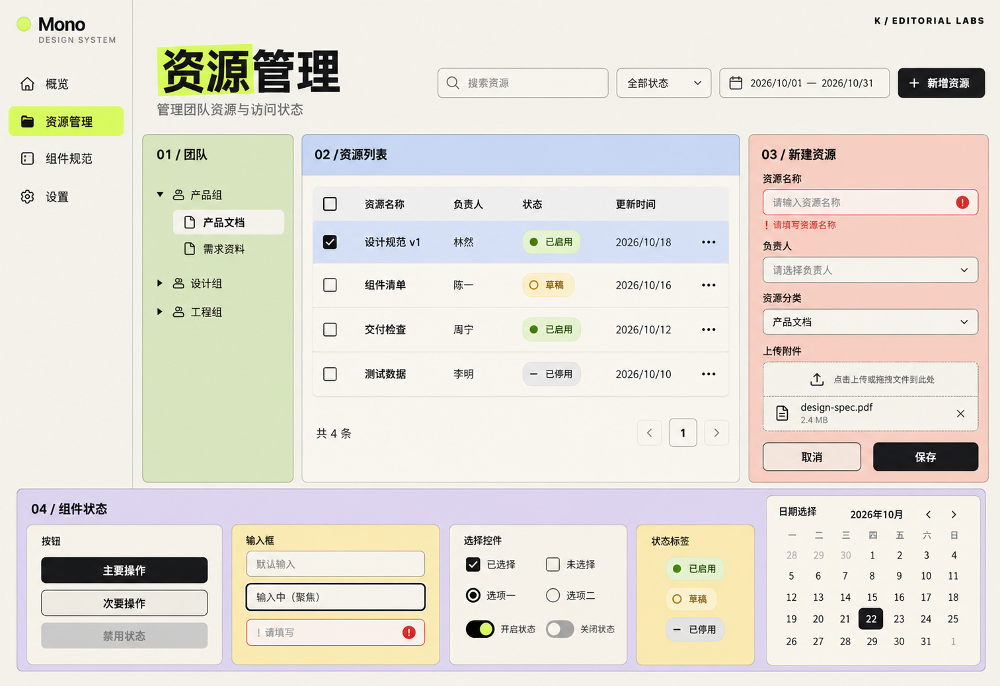

# K：温和的编辑式新粗野主义风格稿

日期：2026-10-22
状态：新增对比候选，未锁定正式设计规范。

## 来源与应用

已读取 [GitHub Pages 页面风格](thread://01a0ebe9-25ef-7442-a53c-51850669d719?hostId=local)，定位到其中对首页的分析：米白底、粗黑标题、粉彩 Bento 卡片、荧光黄绿重点、细描边、小圆角、中英混排与编号标签，兼有瑞士排版和几何趣味。

已实际查看 [Serebiisme 网站](https://serebiisme.github.io/)，保存首页标题与粉彩卡片两张截图，并将二者传入生成工具作为风格参考。原网站的标题、统计和作品入口未沿用到本项目。

适配桌面资源管理工作台：米白背景、粗黑标题、局部黄绿强调，团队区淡绿、表格标题浅蓝、表单珊瑚粉、状态区淡紫与浅黄。表格正文保留浅色底，主操作为黑色实底，错误和状态同时使用图标与文字。借鉴分区和编号关系，保持原有业务内容可比较。

## 设计稿

预期逻辑画布约 1600 × 1100，实际图片 1513 × 1039 像素。结构沿用侧栏、团队树、四行表格、表单、上传及底部组件状态。

## 取舍与检查

- 已查看生成图：主要业务区、表单错误、上传、输入焦点与日历可见。K 的标题和色块更突出，后续采用时需在高密度后台中校准字号及色块面积。
- 模型局部明暗、描边和微观排版仍需真实预览校准；实际对比度、尺寸、键盘操作、日期逻辑和响应式尚未验证。
- 使用内置 image_gen 生成，无后处理，完整提示词、两张参考截图及原图路径见 [prompt.json](prompt.json)。
- 仅交付图片候选与说明，未创建组件代码、发布网站或改动正式设计规范。
