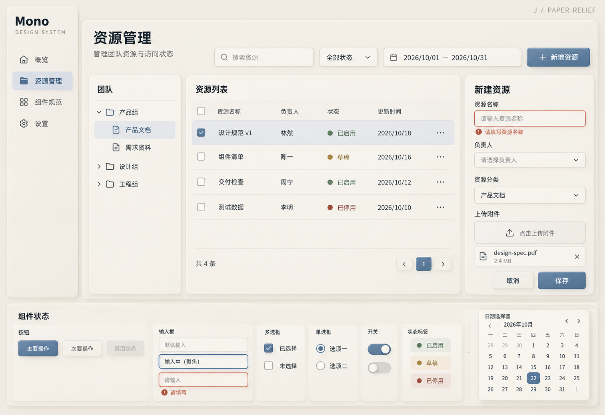

# J：纸艺浅浮雕风格稿

日期：2026-10-22
状态：新增对比候选，未锁定正式设计规范。

## 来源与应用

已读取[新拟态 视觉风格](thread://01a0cc68-bac4-7c43-b9ba-c9e89f7a6e2b?hostId=local)。该会话将图片概括为纸艺浮雕质感的极简 3D 信息可视化插画，带有新拟态特征：奶油白、米色、低饱和灰蓝、鼠尾草绿、芥末黄，以及卡纸、浅浮雕和柔和漫射光。

原图位于历史临时目录，当前已不存在。本轮依据会话文字提炼风格，没有将原图传入生成工具，也不声称还原原始构图。

将材质语言适配为桌面资源管理界面：同色表面浅浅凸起、输入框轻微内凹，灰蓝主操作和柔和语义色形成重点；保留深色文字、细边界、错误说明及焦点轮廓。未将纸张卷曲、实体文件和连接线等插画元素搬入工作区。

## 设计稿

预期逻辑画布约 1600 × 1100，实际图片 1513 × 1039 像素。结构沿用侧栏、团队树、四行表格、表单、上传及底部组件状态。

## 取舍与检查

- 已查看生成图，主要业务区、表单错误、上传、输入焦点及日历可见。纸艺与新拟态用于浅层材质，不作为所有状态的唯一表达。
- 模型生成的纸面明暗、控件阴影及字形不是正式设计变量。真实对比度、尺寸、键盘操作与响应式尚未验证。
- 使用内置 image_gen 生成，无后处理，完整提示词和原图路径见 [prompt.json](prompt.json)。
- 仅交付图片候选与说明，未创建组件代码或改动正式设计规范。
