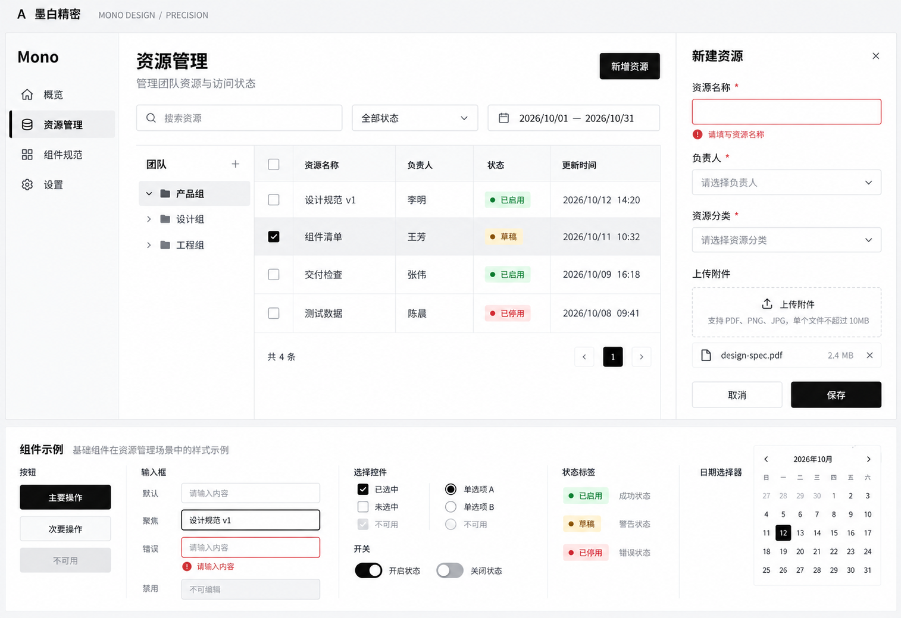
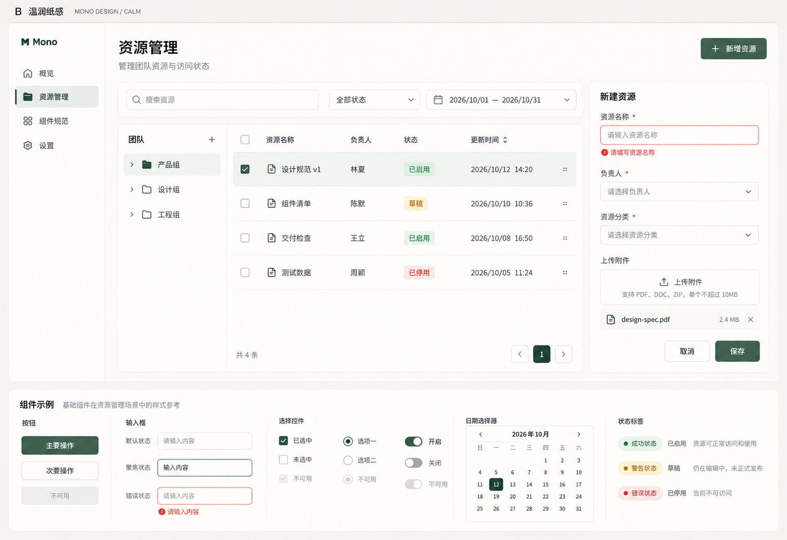
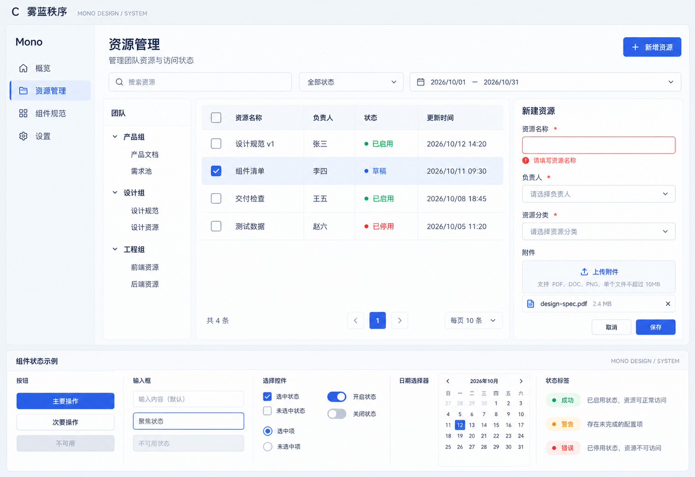

# 组件库风格候选

日期：2026-10-22
状态：历史候选保留。用户最终选择 [G Editorial](../2026-10-22-stylekit-editorial/README.md)，正式规则已写入[设计规范](../../design-system.md)。下文描述保留探索时的取舍。

## 目标与范围

为整个 Mono Design 组件库选择基础视觉方向。保留桌面 B 端、极简视觉、系统字体优先和完整交互的约束，比较边界、层级、密度和强调方式。

三张图使用相同的资源管理业务结构：侧栏、筛选、组织树、四行数据表格、新建表单、上传及组件状态区。下方展示按钮、输入、选择、状态标签和日期日历。模型生成的微观文案、日期、折叠状态和布局存在差异，因此它们用于风格选择，不作为逐像素对照或行为测试基线。

## 对比

| 方向 | 核心视觉关系 | 形状与密度倾向 | 适用取舍 |
| --- | --- | --- | --- |
| A 墨白精密 | 黑白灰、文字与细线建立层级，黑色主操作 | 小圆角、紧凑、平整连续内容区 | 品牌色依赖较少；需细化复杂状态的区分方式 |
| B 温润纸感 | 暖白底、深绿强调、柔和分组 | 较柔和圆角、舒展、安静的容器边界 | 观感更温和；高密度表格仍需专项校准 |
| C 雾蓝秩序 | 冷灰底、蓝色交互标记、明确面板结构 | 中小圆角、适中密度、层级分区 | 选中与反馈醒目；需控制多层边框与强调色面积 |

初轮按极简目标优先讨论 A，随后开展 StyleKit 等方向比较；最终采用 G Editorial，A、B、C 仅作历史比较资料。

## A：墨白精密

## B：温润纸感

## C：雾蓝秩序

## 候选参数与实现边界

这些是提示词中的意图值，尚未从图片逐像素测量，也不是已批准的设计变量。

| 方向 | 提示词中的主要色彩 | 控件圆角 / 高度 / 表格行高意图 |
| --- | --- | --- |
| A | 背景 `#F7F7F8`、表面 `#FFFFFF`、主文字及操作 `#18181B` | 4 / 32 / 40px |
| B | 背景 `#F6F4EF`、表面 `#FFFEFB`、强调 `#315A49` | 8 / 36 / 48px |
| C | 背景 `#F2F5F9`、表面 `#FFFFFF`、强调 `#365BD6` | 6 / 34 / 44px |

参考逻辑画布约为 1600×1100。实际 PNG 尺寸：A 为 1514×1039，B、C 为 1513×1039。具体尺寸、颜色、字号与对比度在选定后通过可实现的设计变量和真实预览校准。

## 生成与检查记录

- 使用内置 image_gen 分别生成三张候选，无外部参考图片，无图片后处理。
- 完整提示词、原始输出位置与本地副本见 [prompts.json](prompts.json)。
- 已查看三张实际图像，主要业务区、四行表格、表单错误、选择与禁用状态及日期示例均可见，无整块内容被裁掉。
- 当前为图片设计稿，文字与控件是图像像素；尚未实现布局、组件、键盘操作、响应式和可访问性验证。
- 未展示暗色，也未逐一设计 70 个组件或高级能力的全部状态。
- UI UX Pro Max 检索提供了极简、网格、系统排版等参考，营销模式和自动字体建议按项目约束过滤。Impeccable 已载入现有上下文，以操作任务、信息层级及状态可见性组织本轮候选；未将图片自查描述为已执行自动 audit。

## 选择后继续

1. 选定 A、B 或 C 作为基础方向，可明确指出一两项希望调整的细节。
2. 形成主色、中性色、语义色、排版、尺寸、边界、焦点和动效的统一约定。
3. 延展复杂表格、树、日期范围、上传队列、弹窗及动态表单的状态稿，并补充暗色方案。
4. 用户确认后更新正式设计规范；实现阶段再通过状态预览、内容边界和实际操作验证。
