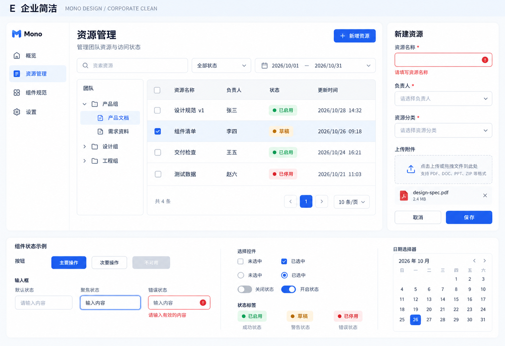

# E：企业简洁风格稿

日期：2026-10-22
状态：新增对比候选，等待反馈；未修改正式设计规范。

## 来源与应用

已读取 [StyleKit Corporate Clean](https://www.stylekit.top/zh/styles/corporate-clean) 的风格说明，并查看其 [Showcase](https://www.stylekit.top/styles/corporate-clean/showcase)。本轮实际截取组件区域并作为生图参考。

提炼蓝色操作、浅灰背景、白色表面、柔和圆角、轻阴影和分明的文字层级，应用于相同的资源管理业务结构。原有组织树、四行表格、新建表单、上传、日期及下方状态区保持同类内容，便于比较。

正文、图标和间距按桌面后台需求组织，没有搬入参考页的营销内容、客户数量或其他业务声明。参考页部分示例与规则存在差异，本轮选择一致的视觉语言，不安装或执行页面代码。

## 设计稿

## 与 D 的比较

| 维度 | D 极简扁平 | E 企业简洁 |
| --- | --- | --- |
| 主要表达 | 黑白、直角、结构线和少量玫红 | 蓝灰、圆角、白色表面与轻阴影 |
| 操作反馈 | 高对比反色、强调色 | 蓝色选中、焦点环和语义色标签 |
| 视觉分量 | 粗字重和明确边界 | 中等字重和柔和分组 |

这是设计稿的实际观察与取舍说明，不是经用户验证的可用性排名。D 原稿见[极简扁平风格稿](../2026-10-22-stylekit-flat/README.md)。

## 生成与检查

- 使用内置 image_gen，实际传入 `reference-showcase.jpg` 作为风格参考，生成一张新稿，无图片后处理。
- 完整提示词及输入输出来源见 [prompt.json](prompt.json)。
- 已查看生成图，主要内容和下方状态示例完整；蓝色主操作、圆角、浅色选中和错误提示均可见。
- 提示词中的色值与尺寸是意图值，尚未校准为实际设计变量。日历、示例日期、对比度、焦点行为、动效与响应式未做产品验证。
- 本轮不编写组件代码、不锁定主题。用户选择后再统一高级组件及暗色设计。
