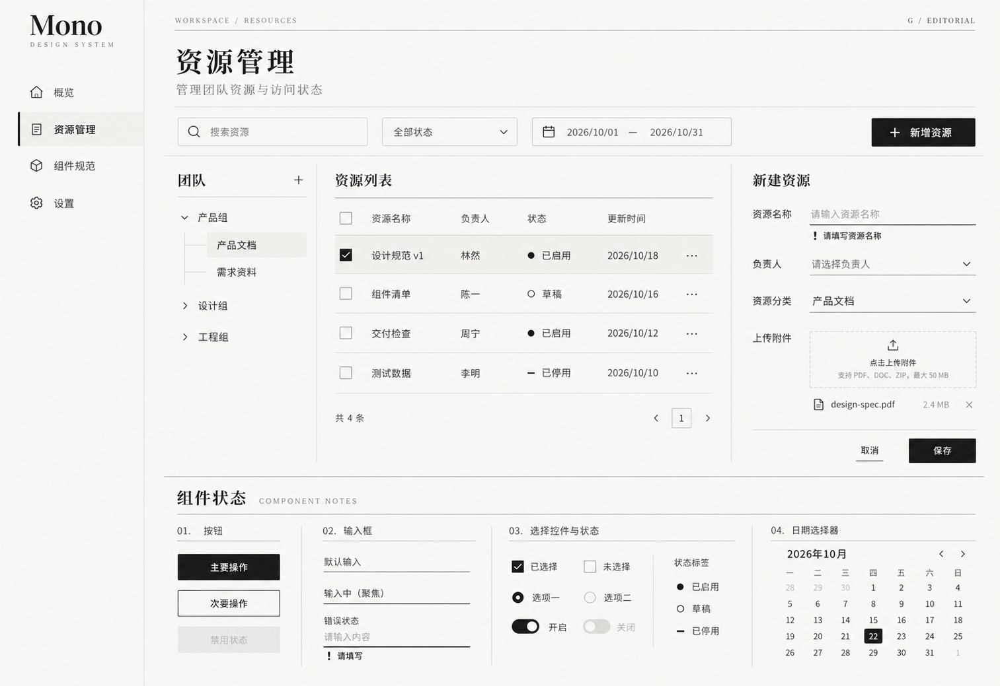

# G：编辑杂志风格稿

日期：2026-10-22
状态：2026-10-22 用户已选择为整库最终视觉方向。正式规则见[设计规范](../../design-system.md)，选择依据见[决策记录 0003](../../decisions/0003-editorial-visual-direction.md)。本图保留为选定方向参考，尚不是实际组件截图。

## 来源与应用

已读取 [StyleKit Editorial](https://www.stylekit.top/zh/styles/editorial) 并查看 [Showcase](https://www.stylekit.top/styles/editorial/showcase)，将实际表单区域截图传入内置生图工具作为风格参考。

提炼暖米色底、柔黑文字、衬线标题、细分隔线和下划线表单。将杂志式排版适配到桌面资源管理场景，保留侧栏、组织树、四行表格、新建表单、上传和下方状态区；未沿用来源中的作品集、摄影及巨幅营销标题。

标题以宋体类衬线字表达编辑感，业务正文与控件以清晰易读为目标。主操作使用柔黑实底；单色状态以实心点、空心点、横线和文字区分，错误用感叹号、说明及加重下划线表达。细线和留白组织层级。

## 设计稿

## 取舍与检查

- G 更侧重排版与阅读感；与 [D 极简扁平](../2026-10-22-stylekit-flat/README.md)、[E 企业简洁](../2026-10-22-stylekit-corporate/README.md)、[F 柔和工具](../2026-10-22-stylekit-soft-utility/README.md)作为历史方案分别保留。当前正式采用 G 的 Editorial 方向。
- 已查看生成图：主要业务区、四行表格、表单错误、上传、日历及下方控件状态可见。生成图的字重、字体覆盖与背景观感仍需工程阶段校准。
- 图片仅表达视觉方向；实际对比度、字体回退、日期逻辑、控件尺寸、响应式及键盘操作尚未验证。
- 使用内置 image_gen 生成一张新稿，无图片后处理。完整提示词、截图及输入输出位置见 [prompt.json](prompt.json)。
- 本图生成时只交付候选与说明；现已将选定方向整理进正式设计规范，未创建组件代码、安装产品依赖或实现设计变量。
