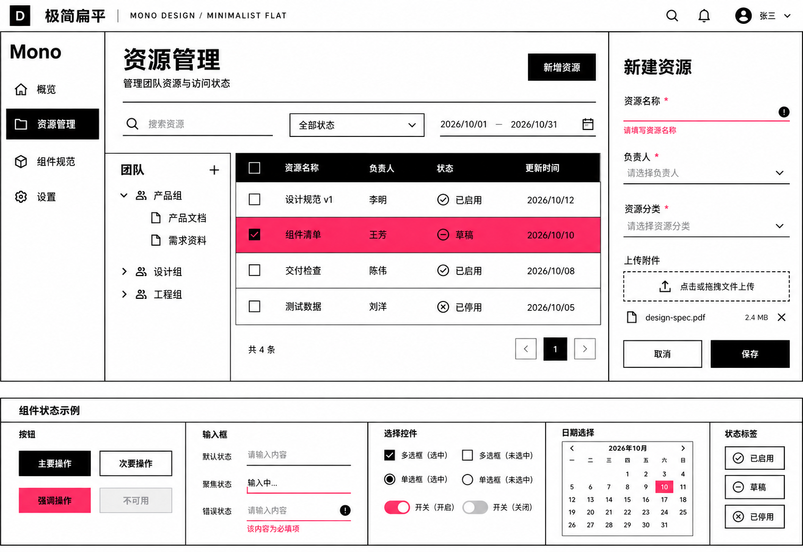

# D：极简扁平风格稿

日期：2026-10-22
状态：用户已指定偏好的风格来源，本稿待反馈；尚未将整套参数写入正式设计规范。

## 参考与提炼

来源：[StyleKit 极简扁平风](https://www.stylekit.top/zh/styles/minimalist-flat)及其 [Showcase](https://www.stylekit.top/styles/minimalist-flat/showcase)。已通过浏览器读取风格说明，并查看实际组件示例。

提炼的主要特征是黑白基底、直角、明确描边、粗字重、留白和克制的强调色，以二维色彩变化表达反馈。参考页的规则与部分示例代码有出入，本轮根据说明和实际画面选择一致的视觉方向，没有安装或执行页面提供的代码。

## 本项目的应用

- 沿用资源管理场景：组织树、筛选、四行表格、创建表单、上传及组件状态区。
- 将灰底和柔和容器换成白底与清晰结构线；主操作和导航使用黑白反色。
- 控件以直角矩形为主；单选与开关保留表达其语义的圆形部件。
- 用玫红强调选中、焦点和必要反馈；不将参考展示页的整块色板或营销布局搬入后台。
- 保持后台可用的控件尺寸和正文层级，标题的视觉分量比上一轮更强。

以上是本次设计选择。提示词中的色值和尺寸是生成意图，尚未测量为实际设计变量。

## 设计稿

## 生成与检查

- 使用内置 image_gen 生成一张新设计稿，实际传入 `reference-showcase.jpg` 作为风格参考；截图不是待编辑的旧稿。
- 参考截图来自实际 Showcase 的组件区域；生成稿原图为 1513×1040，未做图片后处理。
- 已查看生成结果：主要区域、四行表格、错误表单、上传和下方控件状态均可见；直角、黑白与玫红的特征清晰。
- 当前玫红选中行面积较大、结构线也较强，用户反馈后可继续调整强调范围和分隔强度。
- 这是风格概念稿，日历内容、具体状态规则、色值精度、对比度和交互尚未作为产品验证；图像不代表组件已经实现。
- 完整提示词、输入与输出位置见 [prompt.json](prompt.json)。

上一轮 A、B、C 保留为[历史对比](../2026-10-22-style-study/README.md)。下一步根据用户反馈细化本方向，随后统一高级组件和暗色方案。
