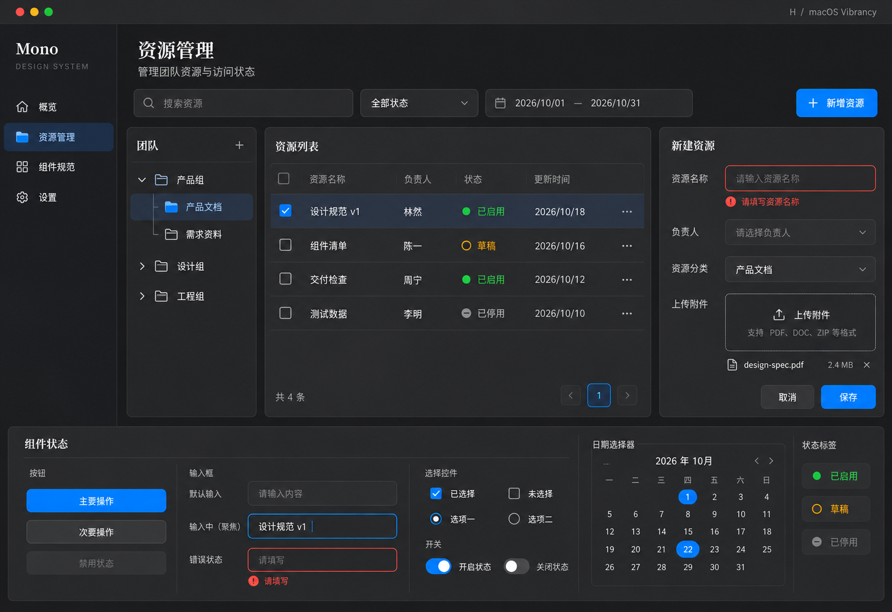

# H：macOS Vibrancy 风格稿

日期：2026-10-22
状态：新增对比候选，未锁定正式设计规范。

## 来源与应用

已读取并实际查看用户提供的 [StyleKit macOS Vibrancy Showcase](https://www.stylekit.top/styles/macos-vibrancy/showcase)，将其中组件区域的实际截图传入内置生图工具作为风格参考。

来源以三层深灰区分侧栏、内容和控件：`#1c1c1e`、`#2c2c2e`、`#3a3a3c`；配合细边框、侧栏半透明模糊、局部系统蓝和小范围语义色。层次以明暗为主，避免发光、彩色壁纸和夸张投影。标题借鉴衬线字体，数据与控件使用清晰的系统无衬线字体。

沿用资源管理对比场景：侧栏、团队树、四行表格、新建表单、上传和底部控件状态。蓝色用于主操作、选中和焦点；成功、草稿、停用与错误同时使用文字和符号。顶部小型三色按钮仅表达原生窗口感，未实现桌面窗口行为。

## 设计稿

预期桌面逻辑画布约 1600 × 1100，实际生成图片为 1513 × 1039 像素，二者不作为控件尺寸的测量依据。

## 取舍与检查

- H 将深色原生工具感作为独立候选，与 [E 企业简洁](../2026-10-22-stylekit-corporate/README.md)、[F 柔和工具](../2026-10-22-stylekit-soft-utility/README.md)、[G 编辑杂志](../2026-10-22-stylekit-editorial/README.md)分别保留；不自动成为整库暗色主题规范。
- 已查看生成图：表格四行、选中、表单错误、上传、输入焦点、选择控件及日历可见。模型的局部明暗过渡、字重与日期标记仍需真实预览校准，日历只表达控件外观。
- 栅格图不能验证实际透明度、背景模糊、对比度、键盘操作、日期逻辑及响应式。若采用此方向，实现时需准备减少透明度及不支持背景模糊时的实色表面回退；本轮未实现或验证这些行为。
- 生成前提炼了参考规则并实际传入截图；使用内置 image_gen 生成一张新稿，无图片后处理。完整提示词及输入输出位置见 [prompt.json](prompt.json)。
- 当前只交付设计稿和说明，未创建组件代码、安装产品依赖或更新正式设计变量。
