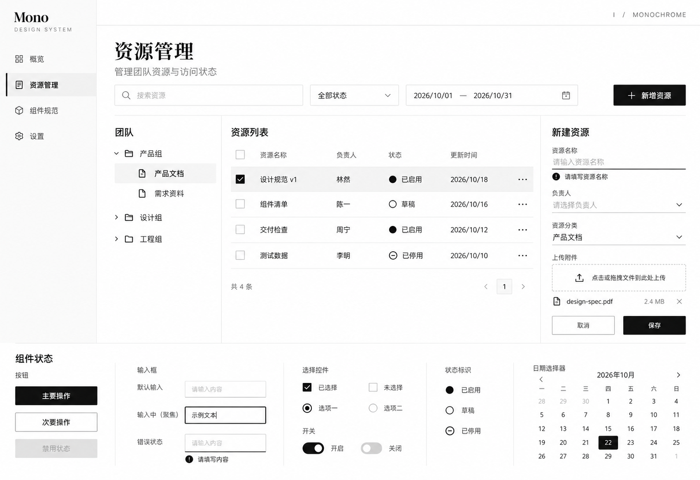

# I：Monochrome 黑白灰风格稿

日期：2026-10-22
状态：新增对比候选，未锁定正式设计规范。

## 来源与应用

已读取并实际查看 [StyleKit Monochrome Showcase](https://www.stylekit.top/styles/monochrome/showcase)，查看按钮和表单展示，将实际表单区域截图传入内置生图工具作为风格参考。

来源以中性黑白灰、字重差异、留白和细线组织层级。将其转化为资源管理工作台：白色与近白表面、深黑主操作、浅灰选中行和细分隔线；不使用彩色强调、投影或渐变。页面标题参考实际示例的衬线形态，业务正文与控件保持系统无衬线字体的可读性。

沿用侧栏、团队树、四行资源表格、新建表单、上传及底部控件状态。状态用实心点、空心点、停用符号与文字区分；错误用感叹号、说明与加重下划线表达；焦点采用黑色清晰轮廓。

## 设计稿

预期桌面逻辑画布约 1600 × 1100，实际生成图片为 1513 × 1039 像素。此图用于方向比较，不作为控件尺寸的测量依据。

## 取舍与检查

- I 更侧重中性灰阶与字重关系；与 [D 极简扁平](../2026-10-22-stylekit-flat/README.md)的粗边界和玫红、[G 编辑杂志](../2026-10-22-stylekit-editorial/README.md)的暖色阅读感分别保留，未自动采纳为默认规范。
- 已查看生成图：四行表格、组织树、新建表单错误、上传、输入焦点、选择控件、状态与日历均可见。日历仅选中 22 日，展示日期与周列相符；图像检查不代表日期逻辑已经实现。
- 纯灰阶方向需要依靠文案、形状和明确焦点维持可辨识度；真实对比度、字体、控件尺寸、键盘操作及响应式尚未验证。来源的动效时长没有直接采纳，若选定此方向将另行评估后台操作反馈与减少动态效果的需要。
- 使用内置 image_gen 生成一张新稿，无图片后处理。完整提示词、参考截图及输入输出位置见 [prompt.json](prompt.json)。
- 本轮只交付图片候选和说明，未创建组件代码、安装产品依赖或更新正式设计变量。
