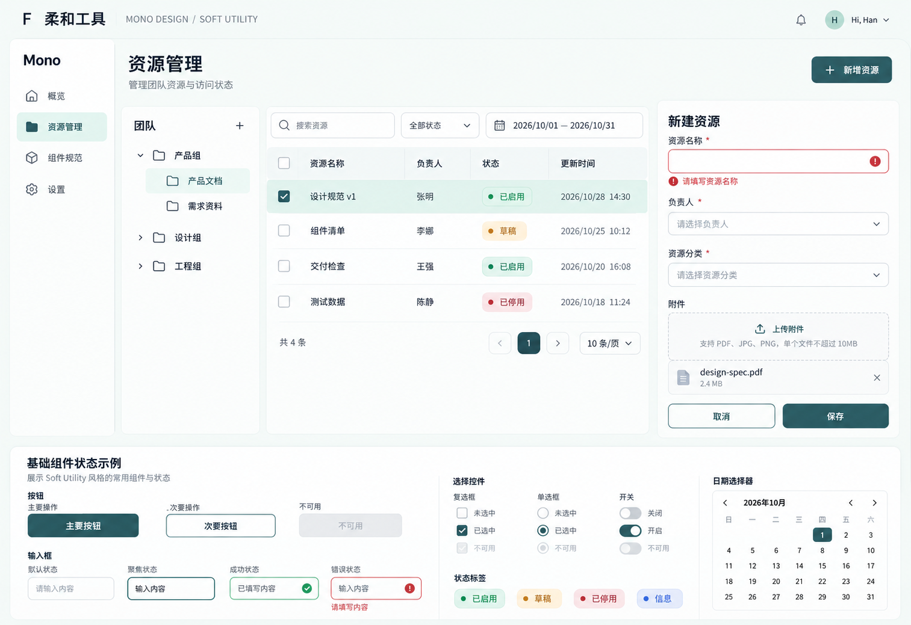

# F：柔和工具风格稿

日期：2026-10-22
状态：新增对比候选，未锁定正式设计规范。

## 来源与应用

已读取 [StyleKit Soft Utility](https://www.stylekit.top/zh/styles/soft-utility) 并查看 [Showcase](https://www.stylekit.top/styles/soft-utility/showcase)，将实际截图传入内置生图工具作为风格参考。

提炼深青色主操作、浅薄荷背景、柔和圆角和清晰状态色。原始方向偏手机工具，本轮将其适配到桌面资源管理场景：保留侧栏、组织树、四行表格、新建表单、上传和下方状态区。

正文采用深色，薄荷、杏色、灰蓝与柔和红用于有含义的状态。保留边界和反馈，桌面布局未引入手机底部导航。

## 设计稿

## 取舍与检查

- F 的色彩和轮廓更柔和，仍以主操作、筛选与状态为中心。与 [E 企业简洁](../2026-10-22-stylekit-corporate/README.md)和 [D 极简扁平](../2026-10-22-stylekit-flat/README.md)分别保留，不自动混合为默认风格。
- 已查看生成图，主要业务区、四行表格、表单错误、上传、日历和下方控件状态可见；图像布局及微观示例数据与前稿存在模型差异。
- 输入、成功、错误和禁用的图像示例不代表行为已经实现；实际对比度、日期、字号、尺寸、响应式及键盘操作尚未验证。
- 使用内置 image_gen 生成一张新稿，无图片后处理。完整提示词、截图及输入输出位置见 [prompt.json](prompt.json)。
- 当前只交付图片候选和说明，未创建组件代码、安装产品依赖或更新正式设计变量。
